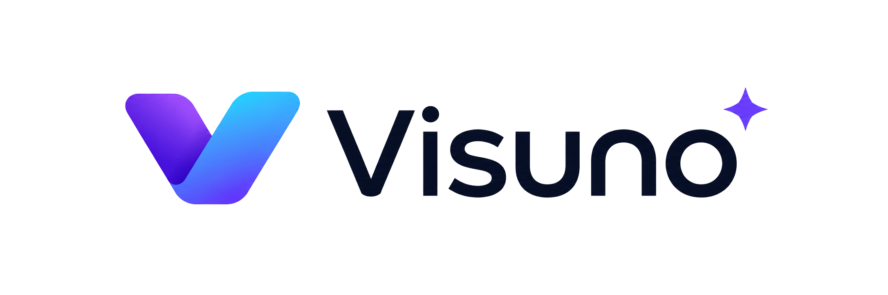

<div align="center">

<picture>
  <source media="(prefers-color-scheme: dark)" srcset="https://raw.githubusercontent.com/Visuno/.github/main/assets/logo-with-text-light.png">
  <source media="(prefers-color-scheme: light)" srcset="https://raw.githubusercontent.com/Visuno/.github/main/assets/logo-with-text.png">
  
</picture>

### Native UI components for AI-agent products — one design, four frameworks.

[](https://visuno.github.io/docs/)
[](https://github.com/Visuno/components/blob/main/LICENSE)

</div>

---

**Visuno** is an open-source component library for building agent interfaces — conversation UIs,
agent-status displays, review-and-approve flows, data views, and workspace tools. Every component
ships natively for **Vanilla JS**, **React**, **Angular**, and **Flutter**, built from a single
shared set of design tokens, so the look and behavior stay identical wherever you build.

## ✦ Highlights

- **Four frameworks, one source of truth.** Design tokens drive color, spacing, radius, and motion
  across every target — no drift between platforms.
- **Light & dark, two styles.** `data-theme="dark"` and a Soft style toggle on the web; the Flutter
  theme mirrors both.
- **Accessible by default.** ARIA roles, live regions, keyboard focus, and reduced-motion support
  are carried into every port.
- **MIT licensed.** Use it, fork it, ship it.

## ✦ Repositories

| Repo | What's inside |
|------|---------------|
| [**components**](https://github.com/Visuno/components) | The library — Vanilla, React, Angular, and Flutter ports plus the shared core tokens |
| [**docs**](https://github.com/Visuno/docs) | Documentation site (Fumadocs) with live examples and code for all four frameworks |
| [**.github**](https://github.com/Visuno/.github) | This profile and shared community health files |
| [**issues**](https://github.com/Visuno/issues) | Cross-repo issue tracking and templates |

## ✦ Get started

Browse the components and copy the code for your framework at
**[visuno.github.io/docs](https://visuno.github.io/docs/)**, or clone
[`components`](https://github.com/Visuno/components) directly.

```html
<!-- Vanilla -->
<span class="bdg" data-tone="success">Live</span>
```

```tsx
// React
<Badge tone="success">Live</Badge>
```

```html
<!-- Angular -->
<dm-badge tone="success">Live</dm-badge>
```

```dart
// Flutter
const Badge('Live', tone: BadgeTone.success)
```

<div align="center">

Made with care for people building with agents.

</div>
